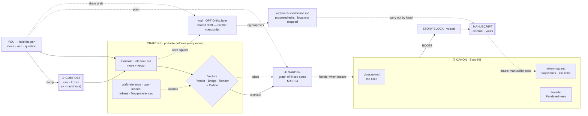

# The Rig — workspace

Status: living · the front door to the workspace

## Why this exists

You are exploring and growing a story. **The rig is the apparatus around the writing** — not the
writing itself. Its whole job is to let us organize ideas, generate on demand, and keep craft
disciplined across many sessions, **without ever touching the manuscript**, which stays yours and
lives elsewhere.

What it buys us:

- **A stable interface.** Collaboration doesn't reset every session — there's a console of named
  moves, so you always know how to put me to work and I always know what you're asking for.
- **A shared language.** Ideas, story block, boost, the three vectors, the lens, tokens — named
  once, used consistently across docs, memory, and conversation. Fewer misunderstandings, no drift.
- **Two knowledgebases.** A **portable Craft KB** (how we work — lifts to any writing project) and
  a **Story KB** bound to this world. Clean separation of the reusable from the particular.
- **A garden for ideas that stays navigable when busy.** Ideas live as small linked notes in one
  graph, flowing raw → cultivated → canon. The garden is laid out as **Victory Gardens** — organised
  into section subdirectories (one per subject/thread, plus `_shared/` for cross-section notes) yet
  **conceptually flat**: it's still one graph, `[[name]]` links resolve by filename (not path), and a
  note moves between sections without breaking anything. Grow in a graph; present it as tended plots.
- **Generation *and* discipline.** The token system both sparks new metaphor (Collide) and keeps
  motifs evolving instead of going stale (trajectories, trail-links).
- **Your voice stays yours.** Edits are always proposed side-by-side; nothing is applied without
  your yes. On a boost I take the pen for one block, then hand it back.
- **It persists.** The whole rig is written to disk and to project memory, so a fresh session —
  even after a full context reset — starts already knowing all of this.

The governing idea: **you hold the pen** (I'm a companion, not a co-author); I assist along a
**named vector**; and the manuscript lives **outside the lens** of this workspace until you
choose to bring a piece of it in.

The workspace is a **three-zone pipeline**, and the directory maps to how *processed* an idea is —
never to what it's *about* (subject is carried by `[[links]]` and tokens, not folders): **①
compost-heap** (raw dumps, frozen) → **② garden** (the living graph of linked idea-notes) → **③
canon** (the Story KB's distilled truth). Ideas flow left to right; finished prose leaves as a
story block to your external manuscript.

Orthogonal to that pipeline is an **optional `wip/` lane** — the one place a piece of the *actual*
draft may live in the rig: the draft you choose to **share** so we can work against it. It is not the
manuscript, not a pipeline stage, and never presumed in sync with your offline copy. The whole model —
pipeline, materials, tokens, canon — is formalized in **`model.json`** at the rig root; this README is
its readable face.

## Flow map

At a glance — the pipeline, driven by the console:

```
  reference layer (Craft KB) ── informs every move ───────────────────────────────┐
  craft-reference · user-manual · interface · tokens · flow-preferences            │
                                                                                   ▼
  YOU ──dump──▶ ① COMPOST ─────────────────▶ CONSOLE ──▶ VECTORS ──cultivate──▶ ② GARDEN
 (hold          raw · frozen                 move+vec    Ponder/Bridge/           graph of
  the pen)      (+ -machinima reaction)                  Render (+Collide)        linked notes
      │  ideas · knot · question                              │                   ▲   │
      └──────────────────────────────────────────────────────┘      plant (both)─┘   │ Render
                                                                                      │ when mature
                                                                                      ▼
                                              BOOST ◀── ③ CANON · Story KB ◀───────────┘
                                          (voiced) │    glossary · token-map · threads
                                                    ▼
                                         STORY BLOCK ──▶ MANUSCRIPT (external · yours)
                                                                      ┆ future: manuscript pass
                                                                      └┄▶ token-map audit

  ── optional, orthogonal lane (NOT a pipeline stage) ─────────────────────────────
  YOU ──share a draft──▶ wip/ ◀──work against── CONSOLE
                          │ rig proposes edits (never in place)
                          └──▶ wip/<wip>-machinima.md  (edit locations mapped in front-matter)
                               └┄▶ carry accepted edits out to the MANUSCRIPT by hand
```

Rendered view (for a markdown viewer with mermaid):



## Modules

### Craft KB — portable (`documents/craft/`)

How we work. Not specific to this story; the whole folder can be lifted into another writing project.

- **`craft-reference.md` — the operating manual.** The core. Holds the collaboration model, the
  **three vectors**, **the lens** (story vs. Act Zero), the **archetypes**, the **edit protocol**,
  the form-agnostic craft rules, and the per-form lenses. *In:* nothing — it's the reference I lean
  on. *Out:* consistent approach across everything else.
- **`interface.md` — the console.** The menu of entry moves (① ideas + vector · ② Act Zero ·
  ③ world/glossary · ④ the knot), each written as a prompt bank so I can drive you through it. Say
  **"menu"** to pull it up. *In:* your choice of move. *Out:* the right next question + the work.
- **`user-manual.md` — how to talk to the rig.** The cheat-sheet of every "way of speech" — the
  trigger phrases that invoke each move, vector, and operation (menu · Ponder/Bridge/Render ·
  Collide · boost · form lenses · edits · voice leans). *In:* "what do I say?" *Out:* the handle.
- **`tokens.md` — the token system.** Design-tokens-for-meaning: how motifs/themes/flaws/objects/
  atmospheres get stable IDs so we can **generate** (Collide) and **track** (trajectories, trail-
  links). Defines the boundary (design layer, not a line-index) and banks the *future* manuscript-
  pass feature. *In:* concepts worth tracking. *Out:* the rules the token-map follows.
- **`flow-preferences.md` — pacing & process.** Your preferences on rhythm and how we work together
  (skeleton, fills as we go). *In:* what you like/dislike in flow. *Out:* tunes my default behavior.

### Story KB — this story (`documents/story/`)

What we know about *this* world. Not portable.

- **`glossary.md` — the Bible.** Single source of truth for the **identity** of every character,
  place, and concept; `[[links]]` weave the web. *In:* load-bearing names (Move 3). *Out:* a world
  that holds still.
- **`token-map.md` — the instrumentation.** This story's actual tokens — registry, **trajectories**
  (how meaning mutates early→mid→late), **trail-links** (the subtext graph), and **collisions to
  try**. References the glossary by ID. *In:* named tokens + Collide results. *Out:* discipline over
  the story's metaphoric layer.
- **`threads/` — Rendered trees.** When a garden cluster matures, **Render** collapses it into a
  clean outline/arc here (links back to its garden notes). *In:* a mature cluster. *Out:* a linear
  view to present or pitch from. Not the manuscript — finished prose leaves as a story block.

### Idea pipeline — the garden (`compost-heap/`, `garden/`)

Where ideas are stored and grown. The directory maps to how *processed* an idea is, not what it's
about. Full model in `documents/craft/user-manual.md` → "The garden".

- **`compost-heap/` — ① raw intake.** Dumps exactly as written; **frozen, append-only, never
  edited.** Reactions to a frozen source live beside it as a **`<source>-machinima.md`** sidecar.
  *In:* your raw dumps. *Out:* the historical origin everything traces back to.
- **`garden/` — ② the living graph (Victory Gardens).** Atomic, linked idea-notes — the graph where
  growth happens — organised into **section subdirectories** (one per subject/thread, plus `_shared/`
  for cross-section notes), yet **conceptually flat**: one graph, `[[name]]` links resolve by filename
  (not path), and moving a note between sections breaks nothing. Folders group; they carry no meaning
  beyond grouping (stage lives in front-matter: `seed→sprout→branch→leaf`; links `[[name]]`/`grew-from`
  carry structure). **Both** of us plant (I only as a move's output, never silently; authorship is
  tagged; I never overwrite yours). `MAP.md` + `_TEMPLATE.md` stay at the garden root; `MAP.md` is the
  hand-kept index, grouped by section. *In:* ideas worth developing. *Out:* a navigable web that
  Renders into canon.

### WIP lane — optional (`wip/`)

The one place a piece of the **actual draft** may live in the rig, if you choose to share it. Orthogonal
to the pipeline — not a stage, no presumption of how developed it is. *In:* a draft you drop in (with a
`kind: wip` header: `shared_at`, `authoritative: false`, `in_sync: unknown`, `covers`). *Out:* proposed
edits, as a **`wip/<wip>-machinima.md`** sidecar whose front-matter maps each edit to its location in the
original WIP — I never edit a WIP in place, and you carry accepted edits out to the external manuscript by
hand. Superseded machinima versions go to `wip/archive/`. Fully optional: this folder may stay empty, and
everything else works without it. Contract: `wip/README.md`; formal entry: `model.json` → `wip` material.

### Wiring & materials (the cross-cutting pieces, defined in the Craft KB)

- **Vectors** — *Ponder* (generate; includes *Collide*), *Bridge* (connect + find gaps), *Render*
  (organize faithfully, no invention). I name which I'm in whenever I act.
- **Bridge out (`render-to-brief`)** — a matured Render thread can be packaged as a **drafting brief** and
  handed to a writing type (`longform`/`explainer`), a Boost, or you. An **export, not a conversion** — the
  rig keeps the map; the draft happens elsewhere. (This rig *maps* the idea; the writing types *draft* it.)
- **The lens** — the **story** is what the viewer's lens witnesses (in-frame); **Act Zero** is what's
  outside it (the seed before plot; what led us to the moment worth witnessing).
- **Archetypes** (leans, never impersonation) — King = voice · Gaiman = craft · Kaufman = screen
  dialogue · Perkins/Bellen = editing.
- **Boost** — the one scoped moment I take the pen: turn ideas into a voiced **story block**.
- **Edit protocol** — Original + Proposed shown side-by-side, structural and line-level; nothing
  applied without your yes.
- **Materials** — **ideas** (your raw input), **story blocks** (voiced draft pieces you carry out
  to the manuscript), and an optional **WIP** (a draft of the actual piece you share into `wip/` to be
  worked with — never the manuscript, never a pipeline stage).

## How a session runs

1. Say **"menu"**, or just start talking and I'll propose the move + vector that fits.
2. Pick a **move** and a **vector**; hand me ideas / the knot / names (fresh, or from a compost dump).
3. I work — naming the vector, leaning on the archetypes and craft rules — and the thinking lands as
   **garden notes** (planted by either of us), glossary/token entries, maps, or (on a **boost**) a
   voiced **story block**.
4. When a garden cluster matures, you say **Render** and I collapse it into a **thread**. You carry
   blocks out to the **manuscript** (external, yours). Occasionally, at a juncture, the manuscript may
   visit for a token pass (*future*).

## Map of files

The workspace is a **pipeline** — raw → cultivated → canon (directory = how *processed* an idea is):

```
<rig root>
├─ model.json           the formal model — pipeline · materials · tokens · canon (machine-readable contract)
├─ compost-heap/        ① raw intake — frozen, append-only
│  ├─ <N>-<slug>.md                 (your raw dumps)
│  ├─ <N>-<slug>-machinima.md       (rig-run reaction sidecar)
│  └─ archive/                      (version snapshots of machinima files)
├─ garden/              ② the living graph — Victory Gardens (section dirs, conceptually flat)
│  ├─ MAP.md                        (hand-kept index / navigation, grouped by section)
│  ├─ _TEMPLATE.md                  (note template)
│  ├─ <section>/                    (one per subject/thread — atomic linked notes)
│  └─ _shared/                      (cross-section notes)
├─ wip/                 ✳ OPTIONAL · orthogonal — the shared draft of the actual piece
│  ├─ <piece>.md                    (a draft you share in; kind: wip header)
│  ├─ <piece>-machinima.md          (rig's proposed edits; locations mapped in front-matter)
│  └─ archive/                      (superseded machinima snapshots)
└─ documents/          ③ the rig + canon
   ├─ README.md         ← you are here (the rig map)
   ├─ craft/            Craft KB · portable
   │  ├─ craft-reference.md
   │  ├─ interface.md
   │  ├─ user-manual.md   (ways of speech + the garden/graph model)
   │  ├─ tokens.md
   │  └─ flow-preferences.md
   └─ story/            Story KB · this story
      ├─ glossary.md
      ├─ token-map.md
      └─ threads/         (Rendered "trees": outlines/arcs)
```

*The rig is a servant. Any module that stops earning its keep gets cut.*
